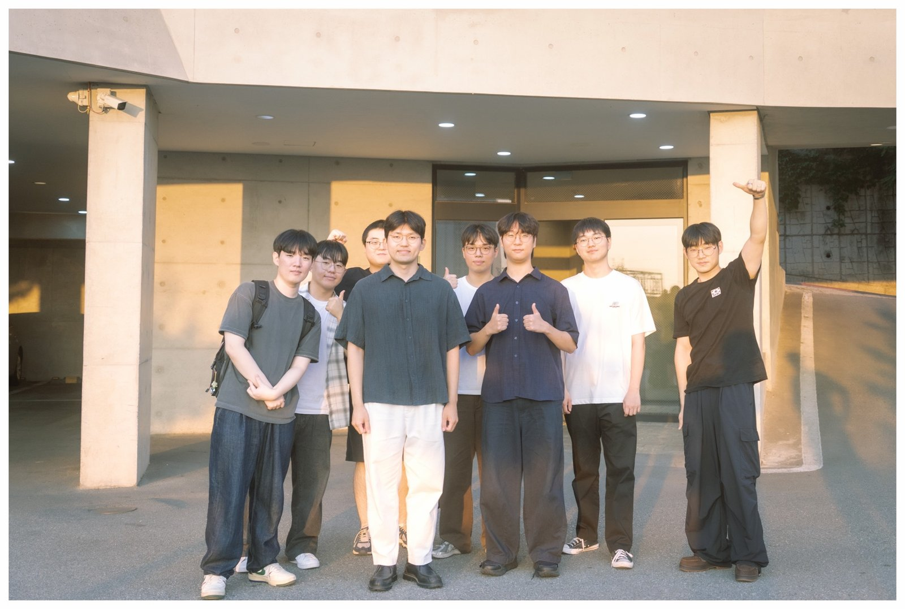

# Welcome to GSEL 👋

GSEL(pronounced *"Gee-sel"*) is a research group dedicated to advancing geospatial science and engineering for a more sustainable and resilient future.

---

## News

- **Oct 27, 2026** — We hosted Prof. Anjin Jang (Michigan State University) for a BK21 invited seminar, *"From Drones to Satellites: Remote Sensing and AI for Environmental Monitoring."*

- **Oct 26, 2026** — We hosted Prof. Euntak Lee (Korea University) for a BK21 invited seminar, *"Assessing the Resilience of Urban Metro Stations Under Large-Scale Sporting Events Using Smart Card Data: A Case Study in Seoul."*

- **Oct 2026** — Jimin Hwang received the **Best Student Paper Award** at the Student Paper Competition of the 2026 KSRS Fall Conference (Busan) for *"High-resolution terrain mapping from global elevation products using geospatial foundation model embeddings."* Congratulations!

- **Oct 2026** — Our paper on transforming leaf-off LiDAR into leaf-on canopy height models was published in *GIScience & Remote Sensing*. [[Paper]](https://doi.org/10.1080/15481603.2026.2740327)

- **Sep 2026** — Our paper on the cross-city reliability of geospatial foundation model embeddings was accepted in *IEEE Geoscience and Remote Sensing Letters*. [[Paper]](https://doi.org/10.1109/LGRS.2026.3732001)
