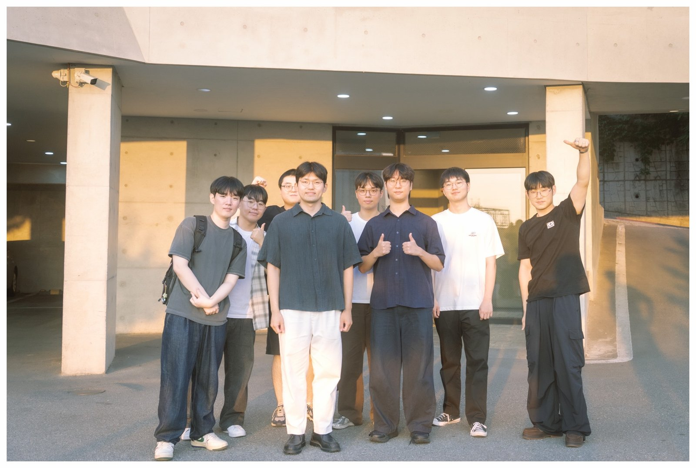

# GSEL 연구실

GSEL(Geospatial Science and Engineering Lab)은 공간 데이터 사이언스와 AI를 활용하여 지속가능하고 회복력 있는 도시를 만들기 위한 연구를 수행합니다.

---

## 소식

- **2026.10.27** — BK21 초청 세미나: 장안진 교수 (Michigan State University), *"From Drones to Satellites: Remote Sensing and AI for Environmental Monitoring"*

- **2026.10.26** — BK21 초청 세미나: 이은탁 교수 (고려대학교), *"Assessing the Resilience of Urban Metro Stations Under Large-Scale Sporting Events Using Smart Card Data: A Case Study in Seoul"*

- **2026.10** — 황지민 학생이 2026년 대한원격탐사학회 추계학술대회(부산) 학생논문경진대회에서 *"High-resolution terrain mapping from global elevation products using geospatial foundation model embeddings"* 연구로 **Best Student Paper Award**를 수상했습니다. 축하합니다!

- **2026.10** — 항공 LiDAR의 낙엽기(leaf-off) 데이터를 활엽기(leaf-on) 수관고 모델로 변환하는 연구가 *GIScience & Remote Sensing*에 게재되었습니다. [[논문]](https://doi.org/10.1080/15481603.2026.2740327)

- **2026.09** — 공간 파운데이션 모델 임베딩의 도시 간 신뢰도를 분석한 연구가 *IEEE Geoscience and Remote Sensing Letters*에 게재 승인되었습니다. [[논문]](https://doi.org/10.1109/LGRS.2026.3732001)
